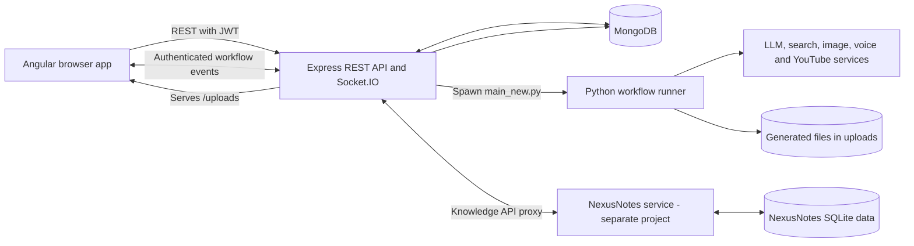
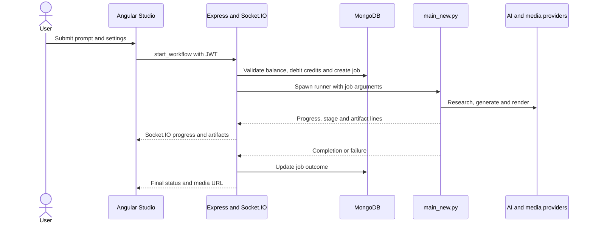
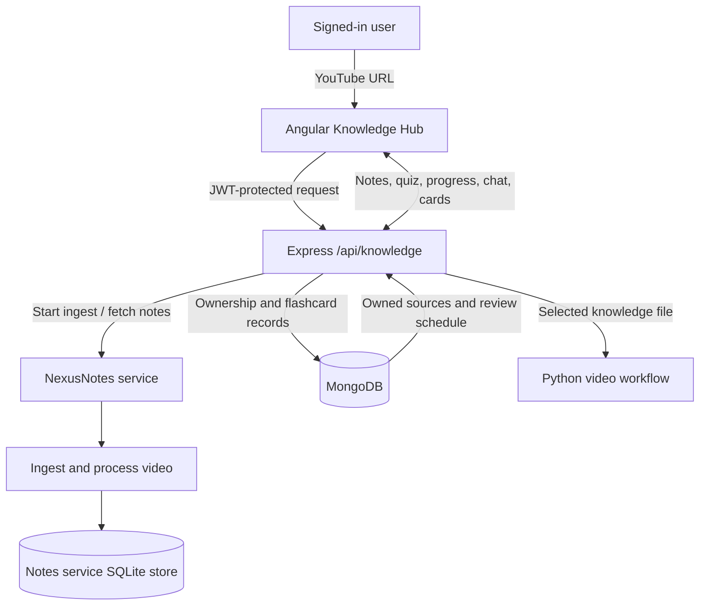
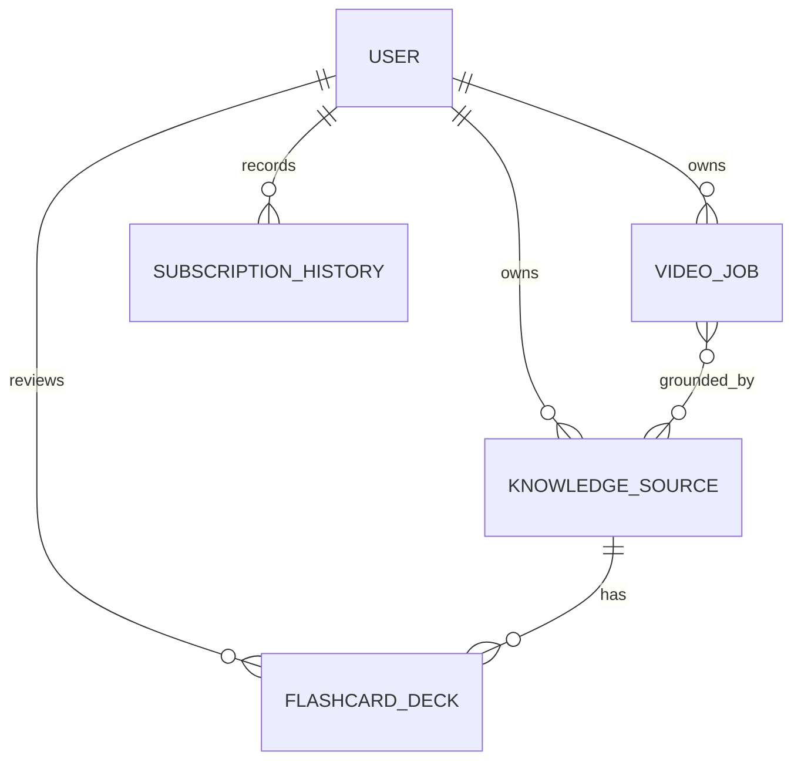

# Nexusverse

**An AI-assisted video creation studio with a companion YouTube knowledge hub.**

Nexusverse combines an Angular web application, an Express API, and Python-based AI/media workflows. Users can request a narrated video, follow its progress in the Studio, and optionally ground the work in material processed by a separate NexusNotes service. A separate Streamlit entry point provides an earlier, manually stepped video-generation prototype.

> **Project status:** This repository contains active application code, but does not include a deployment configuration or the separate NexusNotes service. External APIs, local model assets, credentials, and media tools must be configured before their corresponding workflows can run. This README describes the checked-in implementation; it is not a production-readiness claim.

## Contents

- [Features](#features)
- [Screenshots and demo](#screenshots-and-demo)
- [Architecture](#architecture)
- [Technology stack](#technology-stack)
- [Repository structure](#repository-structure)
- [Prerequisites](#prerequisites)
- [Configuration](#configuration)
- [Local setup](#local-setup)
- [How it works](#how-it-works)
- [API overview](#api-overview)
- [Data model](#data-model)
- [AI and media pipeline](#ai-and-media-pipeline)
- [Security notes](#security-notes)
- [Testing](#testing)
- [Deployment](#deployment)
- [Limitations and possible improvements](#limitations-and-possible-improvements)
- [Troubleshooting](#troubleshooting)
- [Contributing](#contributing)
- [License](#license)
- [Author](#author)

## Features

### Implemented in the application

- **Video workflow Studio:** Submit a prompt, select video settings, monitor progress and generated artifacts over Socket.IO, and pause, resume, cancel, or review the script when those controls are enabled.
- **AI-assisted video generation:** The Python workflow combines research, script writing and review, scene planning, media selection/generation, narration, video rendering, quality checks, and metadata generation.
- **Account and credit flows:** Registration, email OTP verification, login, JWT-based sessions, credit balances, plans, subscription history, profile, and admin-facing views are implemented in the Angular/Express application.
- **Video history and playback:** Completed job records and generated media can be browsed in the Studio/gallery.
- **Knowledge Hub integration:** The Express API stores per-user ownership records for YouTube sources and proxies processing status, notes, quizzes, chat, flashcards, and podcast operations to a separate NexusNotes service.
- **Knowledge-grounded video prompts:** Selected completed knowledge sources can be supplied to a video job as grounding material.
- **Streamlit prototype:** `main.py` exposes an earlier step-by-step workflow for generating and optionally uploading a video.

### Requires external services or local setup

- Video research and writing require configured LLM/search providers.
- Some image, voice, transcription, and rendering paths require substantial local model downloads, GPU resources, FFmpeg, or ImageMagick.
- Email verification requires SMTP for actual email delivery. Without SMTP configuration, the server logs the OTP as a development fallback.
- Knowledge Hub features require the separate NexusNotes service; that service is not included in this repository.
- YouTube upload requires Google OAuth client credentials and a user authorization flow.
- Plans and credit records exist, but this repository does not evidence an integrated payment processor.

### Prototype versus integrated workflow

- `main.py` is the manually stepped Streamlit prototype (`streamlit run main.py`).
- `main_new.py` is the job-oriented workflow runner launched by the Express Socket.IO server. It expects launcher-provided arguments and should be run through the server, not as a standalone prompt application.

## Screenshots and demo

No application screenshots, public demo URL, or demo video are included in the repository at this time.

## Architecture

### High-level system



### Video job workflow



### Knowledge data flow



The Node server defaults to port `4000`, while the checked-in Angular environment points to `http://localhost:8000`. For the documented local setup, set the server's `PORT=8000`, or change `frontend/src/environments/environment.ts` to match the server port.

## Technology stack

| Category | Technology | Purpose |
|---|---|---|
| Frontend | Angular 18, TypeScript, RxJS, Angular Material | SPA, workflow Studio, account and Knowledge Hub pages |
| Backend | Node.js, Express, Socket.IO | REST API, authentication, job coordination and live events |
| Database | MongoDB with Mongoose | Users, jobs, plans, credits, subscriptions, knowledge ownership and flashcard schedules |
| Knowledge processing | External NexusNotes service; SQLite is used by that service | YouTube ingest, notes, quiz and progress data |
| AI orchestration | Python, LangChain, LangGraph and provider SDKs | Research, generation, review and pipeline orchestration |
| AI and search providers | Groq, Tavily, DuckDuckGo, Wikipedia and Arxiv; optional local Ollama critic | Text generation and research, depending on configuration |
| Media sources | Pexels, Wikimedia Commons, Openverse; optional Unsplash configuration | Stock video and real-image lookup |
| Local media/ML | Diffusers, CLIP, XTTS/Piper/Edge-TTS, faster-whisper, MoviePy and FFmpeg | Image generation/scoring, voice, transcription and rendering |
| Email and authentication | Nodemailer, SMTP, bcryptjs, JSON Web Tokens | OTP delivery, password hashing and API sessions |
| Testing | Jasmine/Karma through Angular CLI | Frontend component tests |
| Deployment | No deployment platform/configuration verified in this repository | — |

## Repository structure

```text
.
├── main.py                         # Manually stepped Streamlit prototype
├── main_new.py                     # Server-launched Python video workflow
├── requirements.txt                # Python dependencies
├── .gitignore                      # Excludes credentials and generated data
├── agents/                         # Research, media, narration and QA agents
│   ├── research_agent.py, news_agent.py, info_generator.py
│   ├── script_writer.py, critic.py, knowledge_grounding.py
│   ├── image_generation.py, real_image_agent.py, stock_videos.py
│   ├── text_to_speech.py, voice_clone.py
│   ├── captioned_video.py, video_generation.py, video_effects.py
│   ├── audio_master.py, bg_music.py, podcast_audio.py, podcast_writer.py
│   ├── qa_agent.py, observability.py, clip_utils.py
│   ├── used_media_registry.py
│   └── youtube_metadata.py, upload_to_YT.py
├── frontend/
│   ├── package.json, package-lock.json
│   └── src/app/
│       ├── components/             # Landing, login, workflow, profile, admin, etc.
│       ├── modules/knowledge/      # Knowledge Hub screens
│       ├── modules/studio/         # Video gallery
│       ├── services/               # REST, auth and workflow services
│       ├── core/                   # Guards, tracking and app-wide services
│       └── shared/                 # Reusable UI components
├── server/
│   ├── package.json, package-lock.json
│   ├── src/
│   │   ├── app.js, server.js       # Express app and HTTP/Socket.IO startup
│   │   ├── routes/                 # Auth, videos, history, plans, knowledge, etc.
│   │   ├── controllers/             # Auth and video request handlers
│   │   ├── sockets/                # Live workflow coordination
│   │   ├── services/                # Python worker, notes proxy, podcast, etc.
│   │   ├── models/                  # Mongoose schemas
│   │   └── utils/                   # Auth, email and upload helpers
│   ├── python_workers/              # Python helper scripts
│   └── uploads/                     # Runtime media output (not source)
├── scripts/
│   └── start-notes.ps1              # Local NexusNotes launcher; machine-specific
├── Dark cinematic AI landing page/
│   ├── Agentic YouTube.dc.html      # Standalone landing-page HTML
│   └── support.js                   # Related standalone page script
└── uploads/, stock_videos/, resized_images/
                                    # Runtime/generated media; excluded by .gitignore
```

## Prerequisites

- Git.
- Node.js and npm versions supported by Angular CLI 18.
- Python and pip compatible with the packages in `requirements.txt`.
- A MongoDB instance and its connection URI.
- FFmpeg; ImageMagick may be needed for configured image/video paths.
- Provider credentials for whichever AI, search, media, email, and upload features you enable.
- Optional: a CUDA-capable GPU and compatible PyTorch build for local image/voice/transcription workloads.
- Optional: a separately installed and running NexusNotes backend for Knowledge Hub functionality.

The Python requirements include large ML packages. Installation and runtime resource use depend on the machine and selected engines; the requirements file also notes that GPU stages need a matching CUDA-enabled PyTorch build.

## Configuration

The Node service loads `server/.env` when started from the `server` directory. Python worker processes inherit the server process environment. The Streamlit prototype is started from the repository root and needs its provider variables available in that process.

Create local environment files from the following templates. Replace placeholders with your own values; never commit populated `.env` files, OAuth secrets, tokens, or credential pickles.

### `server/.env`

```dotenv
# Required for the Express application
MONGO_URI=mongodb://127.0.0.1:27017/nexusverse
JWT_SECRET=replace-with-a-long-random-secret
JWT_EXPIRES_IN=7d
PORT=8000

# Python workflow process
PYTHON_PATH=C:/path/to/Nexusverse/.venv/Scripts/python.exe
PY_MAIN_PATH=C:/path/to/Nexusverse/main_new.py
UPLOAD_DIR=C:/path/to/Nexusverse/server/uploads
FFMPEG_PATH=ffmpeg

# Needed for actual verification emails; without these the OTP is logged locally
SMTP_HOST=
SMTP_PORT=587
SMTP_USER=
SMTP_PASS=
FROM_EMAIL=

# Optional external NexusNotes backend
NOTES_SERVICE_URL=http://localhost:8100
NOTES_DATA_DIR=

# Google OAuth client file for YouTube upload, if enabled
CLIENT_SECRETS_FILE=C:/path/to/client_secret.json
```

`PORT=8000` aligns Express with the Angular origin in `frontend/src/environments/environment.ts`. If you choose another port, update that Angular environment file too. Set `PYTHON_PATH` to the Python interpreter where `requirements.txt` has been installed.

### Python workflow variables

The exact set depends on which agents you use. The main provider and feature variables include:

```dotenv
GROQ_API_KEY=
GROQ_MODEL=
TAVILY_API_KEY=
TAVILY_SEARCH_API_KEY=
PEXELS_API_KEY=
UNSPLASH_ACCESS_KEY=
HUGGINGFACE_API_KEY=
YOUTUBE_API_KEY=
CLIENT_SECRETS_FILE=

# Optional local models and media tools
TTS_ENGINE=
XTTS_SPEAKER_WAV=
PIPER_MODEL_PATH=
WHISPER_MODEL=
FFMPEG_PATH=
IMAGEMAGICK_BINARY=
MUSIC_LIBRARY_DIR=
UPLOAD_DIR=

# Optional tracing
LANGCHAIN_API_KEY=
LANGCHAIN_PROJECT=
```

Other tuning variables in the code configure model selection, news mode, image quality, media mix, captions, audio mastering, video orientation, QA thresholds, checkpoints, and tracing. Set only the variables needed by the agents you intend to run. The `.env` files present on a developer machine are intentionally not documented with their values.

For the integrated web workflow, put the Python provider/model variables in `server/.env` as well; the server passes its environment to the Python worker. For the standalone Streamlit prototype, make those variables available to the Streamlit process from the repository root.

For Google upload, configure a Google OAuth client JSON file locally and point `CLIENT_SECRETS_FILE` to it. The generated user authorization credential is local runtime data and must not be added to Git.

## Local setup

### 1. Clone the repository

```powershell
git clone https://github.com/Yash798dev/Nexusverse.git
Set-Location .\Nexusverse
```

### 2. Install Python dependencies

```powershell
py -m venv .venv
.\.venv\Scripts\Activate.ps1
python -m pip install --upgrade pip
pip install -r requirements.txt
```

If PowerShell prevents virtual-environment activation, use the interpreter directly: `.\.venv\Scripts\python.exe -m pip install -r requirements.txt`.

### 3. Configure and start MongoDB

Start a local MongoDB instance or provision a hosted one, then set `MONGO_URI` in `server/.env`. The application connects to MongoDB during server startup and exits if the connection fails.

### 4. Install and start the Express server

Create `server/.env` using the template above, then:

```powershell
Set-Location .\server
npm ci
npm start
```

The server connects to MongoDB, then starts Express and Socket.IO. With the documented `PORT=8000`, the health endpoint is `http://localhost:8000/`. If email credentials are omitted, verification OTPs are printed to the server console for development.

### 5. Install and start the Angular app

In a second PowerShell terminal opened at the repository root:

```powershell
Set-Location .\frontend
npm ci
npm start
```

Open `http://localhost:4200/`. The frontend's API and Socket.IO origin is currently set in `frontend/src/environments/environment.ts`.

### 6. Enable optional Knowledge Hub functionality

The Knowledge Hub depends on a separate NexusNotes service, configured through `NOTES_SERVICE_URL` (default `http://localhost:8100`). That project and its dependencies are not included here. `scripts/start-notes.ps1` contains machine-specific absolute paths to a local NexusNotes checkout and Python installation; update those paths before using the script on another machine.

### 7. Run the standalone prototype (optional)

From the repository root, with the Python environment activated and required provider variables configured:

```powershell
streamlit run main.py
```

`main_new.py` is not a substitute for this command; it is launched by the Node workflow server with a job ID and prompt.

## How it works

1. A user signs in through the Angular UI. The Express service stores users in MongoDB, hashes passwords with bcrypt, verifies email using an OTP, and issues a JWT.
2. The Workflow page connects to Socket.IO using that JWT and sends `start_workflow` with a prompt, optional settings, and optional knowledge source IDs.
3. The server validates the prompt/settings, checks and debits credits, creates a `VideoJob`, and launches `main_new.py` as a child process.
4. The Python graph runs research and script generation/review, plans scenes, gathers or generates visual media, synthesizes narration, renders the video, performs configured QA, and produces metadata.
5. The child process writes machine-readable progress/artifact lines. Express relays them to the user's socket room, saves job state, and exposes generated files under `/uploads`.
6. The Angular app renders progress, artifacts, and the final video. A reconnecting user can receive the active job and artifacts again.
7. If the run uses knowledge sources, the Node service checks ownership and prepares a grounding file before launching Python. Notes and knowledge processing remain in the separate NexusNotes service.

The workflow supports prompt settings including duration, tone, voice, language, orientation, and optional script review. The server applies a whitelist to workflow settings before spawning the Python process.

## API overview

The REST API is mounted at `/api`. Protected routes expect an `Authorization: Bearer YOUR_JWT` header. The primary video-generation start/control interface is Socket.IO; older video REST handlers also remain in the source.

| Method | Path | Auth | Purpose / request |
|---|---|---|---|
| `POST` | `/api/auth/register` | No | Register with `name`, `email`, `password`, and `confirmPassword`; sends an OTP |
| `POST` | `/api/auth/verify-otp` | No | Verify using `email` and `otp` |
| `POST` | `/api/auth/login` | No | Login using `email` and `password`; returns a JWT and user summary |
| `GET` | `/api/user/me/credits` | Yes | Read the signed-in user's credit balance |
| `GET` | `/api/history/my?page=1&limit=20` | Yes | Paginated video jobs for the signed-in user |
| `GET` | `/api/history/profile` | Yes | Read the signed-in user's profile |
| `GET`, `POST` | `/api/history/videos`, `/api/history/subscriptions` | Yes | Read or create history records |
| `GET` | `/api/plans` | No | List plans |
| `POST` | `/api/plans` | **No (implementation gap)** | Plan creation handler; currently not protected by auth middleware |
| `GET` | `/api/admin/users`, `/api/admin/video-jobs` | Admin JWT | List users or video jobs |
| `POST` | `/api/videos/create` | Yes | Legacy/incomplete handler; the Angular workflow starts jobs over Socket.IO |
| `GET` | `/api/videos/:jobId` | Yes | Fetch a video job |
| `POST` | `/api/videos/upload/:jobId` | Yes | Start upload; body includes `youtubeEmail` |
| `POST` | `/api/subscription/:planId` | Yes | Create a subscription/credit record |
| `POST`, `GET` | `/api/knowledge` | Yes | Start ingest with `{ "url": "https://..." }`; list the user's sources |
| `GET` | `/api/knowledge/:id` | Yes | Read source status and, when ready, notes and quiz |
| `GET` | `/api/knowledge/:id/progress` | Yes | Server-Sent Events progress stream |
| `GET` | `/api/knowledge/:id/flashcards` | Yes | Read/generate the source's flashcard deck |
| `POST` | `/api/knowledge/:id/flashcards/review` | Yes | Review body: `cardId`, `grade` (`again`, `hard`, `good`, or `easy`) |
| `POST`, `GET` | `/api/knowledge/:id/podcast` | Yes | Start and inspect a podcast render |
| `POST` | `/api/knowledge/:id/chat` | Yes | Ask a question with `question` and optional conversation `history` |
| `GET` | `/api/knowledge/:id/keyframe?path=...` | Yes | Serve an owned source's configured keyframe |
| `POST` | `/api/knowledge/:id/retry` | Yes | Retry a failed knowledge ingest |

### Example login request

```http
POST /api/auth/login
Content-Type: application/json

{
  "email": "user@example.com",
  "password": "your-password"
}
```

The successful response includes `ok`, `token`, and a limited `user` object. Subsequent protected REST calls send it as `Authorization: Bearer YOUR_JWT`.

### Workflow Socket.IO events

The client authenticates the socket with `{ auth: { token } }`. Main client-to-server events are:

- `start_workflow`: `{ prompt, config?, knowledgeSourceIds? }`
- `submit_script`: `{ script }` or `{ cancel: true }` when script review is pending
- `pause_workflow`, `resume_workflow`, `cancel_workflow`

The server reports events including `workflow_started`, `workflow_rejected`, `workflow_active`, `workflow_progress`, `workflow_stage`, `workflow_artifact`, `workflow_log`, `workflow_error`, `workflow_complete`, and workflow-control/script-review events. See `server/src/sockets/workflowSocket.js` and `frontend/src/app/services/workflow.service.ts` for the event contract.

## Data model

MongoDB is accessed through Mongoose. Important collections/models include:

| Model | Purpose |
|---|---|
| `User` | Account, password hash, verification state, role, credits and subscription references |
| `VideoJob` | Prompt, status, progress, output paths, settings, credit cost and knowledge attribution |
| `KnowledgeSource` | Per-user ownership record and status mirror for a NexusNotes ingest |
| `FlashcardDeck` | Per-user cards, review grades and spaced-repetition schedule |
| `Plan`, `SubscriptionHistory`, `CreditTransaction` | Plan and credit/subscription records |
| `Otp` | Email verification codes and expiry |
| `VideoHistory`, `ContentProject` | Additional/legacy content records |

The notes, transcript-derived content, and quiz remain in the external notes service's data store; MongoDB keeps the account ownership link and flashcard scheduling state.



## AI and media pipeline

- **Research and writing:** LangChain/LangGraph agents use configured LLM and search providers to research a topic, create a script, and run a critic/revision step.
- **Optional user grounding:** Knowledge source material can be prepared from the user's selected sources and passed into the video workflow.
- **Visuals:** The workflow can use local diffusion models with CLIP-based scoring, real-image lookup, and Pexels stock videos, depending on configuration and availability.
- **Narration/audio:** Configurable speech engines include Edge-TTS, XTTS and Piper paths. Audio mastering, background music, and caption/transcription components are implemented as separate agents.
- **Rendering and checks:** Python video/audio components use FFmpeg and supporting libraries; QA checks are configurable and are not a guarantee of correct or publishable output.
- **YouTube:** Upload uses the Google YouTube Data API/OAuth flow when credentials are configured. The integrated workflow's upload behavior and privacy settings should be reviewed before use.

The availability, licensing terms, quality, latency, and cost of these services depend on provider accounts, model licenses, local configuration, and live service responses. In particular, the XTTS-v2 integration is marked in code as non-commercially licensed; review each model/provider's license before commercial use.

The current integrated upload path is configured to publish successful uploads publicly. Verify the target channel and visibility behavior before enabling uploads.

## Security notes

Implemented controls include bcrypt password hashing, JWT authentication middleware, admin role checks on admin routes, user-scoped knowledge-source lookups, and whitelisted workflow settings before process launch.

The current code also has important gaps that must be addressed before public deployment:

- `JWT_SECRET` has a weak hard-coded fallback in the authentication controller. Always configure a long, random secret; ideally remove the fallback in application code before production.
- Express CORS and Socket.IO CORS are permissive. Restrict allowed origins for the deployment.
- `POST /api/plans` is not protected by the admin middleware in its current route implementation.
- SMTP is optional and falls back to printing OTPs to server logs; do not expose logs in a real deployment.
- Keep all API keys, OAuth JSON, OAuth token/pickle files, database credentials, and generated/private user data out of source control. Rotate credentials if they were ever exposed.
- Review upload privacy, file retention, provider data handling, rate limits, validation, and authorization on all endpoints before exposing the service publicly.

The repository's `.gitignore` excludes environment files, Google credential files, credential pickles, and generated media/data directories. Ignore rules do not remove files already tracked in Git history.

## Testing

The Angular project contains Jasmine/Karma component specs. Run them with:

```powershell
Set-Location .\frontend
npm ci
npm test
```

No backend or Python test command is defined in the checked-in package manifests. Test coverage and test results have not been independently verified as part of this documentation.

## Deployment

No Dockerfile, CI deployment workflow, or hosting-specific deployment guide was found in the repository. A production deployment would need, at minimum:

1. A supported Node/Python runtime and installed media/model dependencies.
2. A secured MongoDB deployment and production environment variables.
3. A server port/origin configuration consistent with the built Angular app.
4. Restricted CORS, strong secrets, secure SMTP, HTTPS, and an appropriate process manager.
5. Persistent and access-controlled storage for generated media, with cleanup/retention policy.
6. A separately deployed NexusNotes service if Knowledge Hub features are required.
7. Review of external API quotas, model/provider licenses, YouTube OAuth scopes, and upload visibility.

The local Python scripts and model requirements should be load-tested on the target machine before hosting the generation service.

## Limitations and possible improvements

These are recommendations, not a declared project roadmap:

- Add a real `.env.example` file and validate required settings at startup.
- Remove the weak JWT fallback and secure plan creation behind admin authorization.
- Replace permissive CORS settings with an allowlist and add request rate limits.
- Add backend/Python integration tests and a reproducible CI pipeline.
- Document, version, or integrate the separate NexusNotes service; replace machine-specific paths in its launcher.
- Add deployment/container configuration and define persistence and cleanup for user-generated media.
- Clarify which legacy REST job handlers are supported versus the Socket.IO workflow path.
- Add real screenshots, demo media, and a public feature roadmap when available.

## Troubleshooting

| Symptom | Checks |
|---|---|
| Server exits while connecting to MongoDB | Confirm MongoDB is running and `MONGO_URI` is set in `server/.env`. |
| Frontend loads but API/socket is unavailable | The Angular environment points to port `8000`; set server `PORT=8000` or update the frontend API/socket origins, then restart both processes. |
| Workflow cannot launch Python | Set `PYTHON_PATH` to the virtual environment interpreter and `PY_MAIN_PATH` to this repository's `main_new.py`; install `requirements.txt` into that interpreter. |
| LLM/search requests fail | Check the relevant provider key, account quota, network access, and configured model/provider name. |
| Video rendering or image tools fail | Verify FFmpeg/ImageMagick availability and paths; check free disk space, model downloads, GPU/CUDA compatibility, and local media assets. |
| No verification email arrives | Configure valid SMTP host/user/password/port. In development without SMTP, the OTP is written to the server console. |
| Knowledge Hub requests fail | Start the separate NexusNotes service and check `NOTES_SERVICE_URL`; the service is not part of this repository. |
| YouTube upload fails | Verify the OAuth client file path, Google API enablement, user authorization, and token availability. Never commit OAuth files. |
| PowerShell blocks venv activation | Run the venv interpreter directly for pip commands, or use an execution policy appropriate for your machine. |

## Contributing

Contributions are welcome. Before opening a pull request:

1. Fork the repository and create a focused branch, for example `fix/workflow-timeout`.
2. Keep changes scoped, document configuration changes, and never include secrets or generated media.
3. Run the relevant Angular tests and manually verify affected backend/Python behavior where practical.
4. Open a pull request describing the motivation, implementation, configuration changes, and validation performed.

No separate contribution or code-style guide is currently included.

## License

No `LICENSE` file was found in this repository. Until a license is added, reuse, redistribution, and contribution rights are not specified.

## Author

Repository owner: [Yash798dev](https://github.com/Yash798dev)

Repository: [Nexusverse](https://github.com/Yash798dev/Nexusverse)
